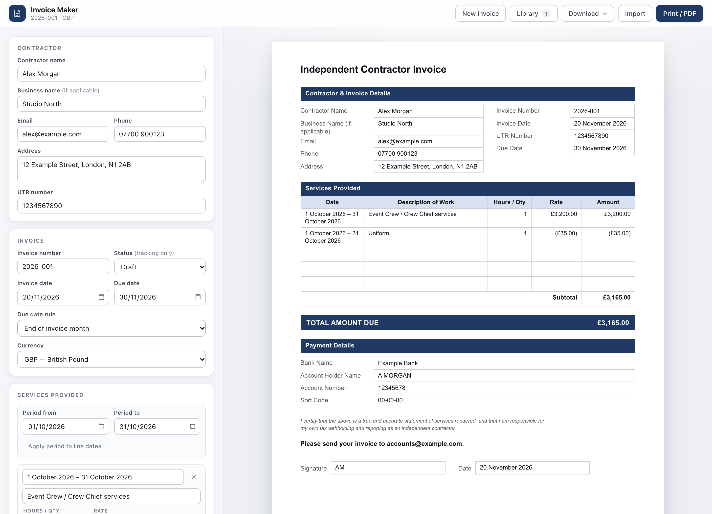
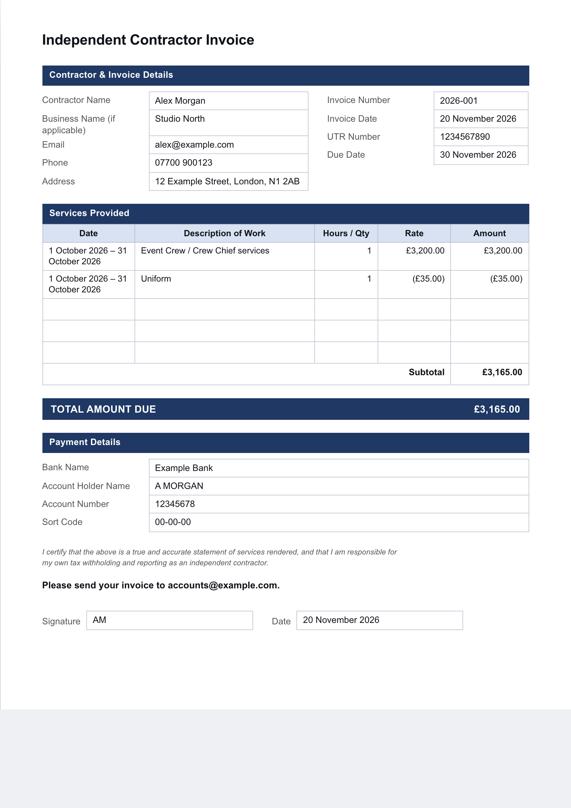
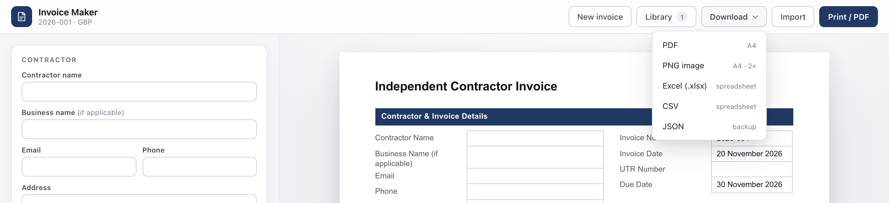
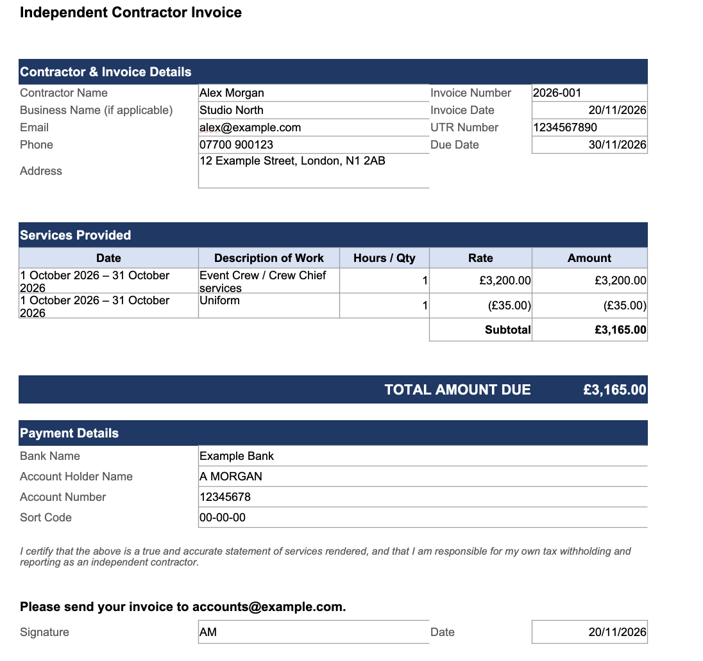
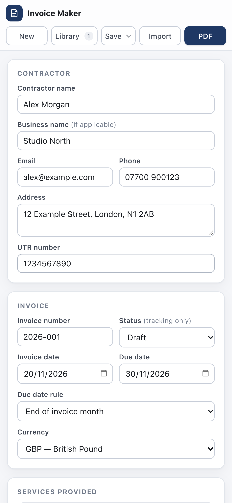

# Invoice Maker

A local-first invoice builder for independent contractors — one small HTML/CSS/JS app you can open
in a browser, or build into a native macOS app. No accounts, no cloud, no tracking, no build step.



It produces a clean A4 invoice laid out like a classic contractor invoice form:



## Features

- **Live A4 preview** while you type, and a print-perfect page on paper.
- **Automatic maths** — line amounts, subtotal and total due. Negative lines (deductions, expenses
  you're returning) print in accounting brackets, e.g. `(£35.00)`.
- **Numbering** — `YYYY-NNN`, incremented for each new invoice.
- **Billing period helper** — new invoices default to the previous calendar month; one click pushes
  the period onto every line. A 15th → 14th cycle is available with one setting.
- **Due-date rules** — end of invoice month, on receipt, 14 days or 30 days.
- **Invoice library** — open, duplicate or delete past invoices; everything autosaves.
- **Downloads** — PDF (macOS app), PNG image, **Excel (.xlsx)**, CSV and JSON backup of any invoice.
- **Export / Import** — JSON files move an invoice between browsers or machines.
- **Currency** — GBP by default, with EUR and USD available.
- **Works offline** — everything runs from the local files.

## Use it in a browser

Open `index.html` (double-click it). That's it.

If you prefer a URL:

```bash
python3 -m http.server 8080   # then open http://localhost:8080
```

Data is kept in that browser's `localStorage`.

## Build the macOS app

Requires macOS 13+ and the Xcode Command Line Tools (`xcode-select --install`).

```bash
cd mac
./build.sh
open "build/Invoice Maker.app"
```

Then drag the app to `/Applications` if you want it in Launchpad / Spotlight.

The wrapper is a normal AppKit app: it serves the bundled page from `127.0.0.1:47823` (that's how its
storage persists reliably), shows it in a `WKWebView`, and prints by rendering the page to an A4 PDF
first — so `⌘P` → **PDF ▸ Save as PDF** always gives exactly one clean page.

Before publishing your own build, change the bundle identifier in `mac/Info.plist` and
`mac/build.sh` (`com.example.invoicemaker`) to something of your own; the app's data lives in
`~/Library/WebKit/<bundle-id>`.

## Printing

- **macOS app:** `⌘P` or the **Print / PDF** button → macOS print dialog → **PDF ▸ Save as PDF**.
- **Browser:** print with **A4**, **Margins: None**, **Background graphics: on**.

One invoice fits one A4 sheet with up to **8 service lines**; a 9th line spills onto a second page.

## Importing a statement (macOS app)

If your invoices come from a shift/pay statement PDF, the app can read it for you:

**File ▸ Import Statement PDF…** (⇧⌘I), the **Import statement PDF…** link under *Services provided*,
or just the top-bar **Import** button — it now accepts either a statement PDF or a JSON backup and
routes them automatically.

It pulls the **Total Pay** figure and the statement period out of the PDF and fills the invoice on
screen (or starts the next one) with a single service line. Add any deduction — e.g. a uniform
repayment as a negative `Rate` — then **Download ▸ PDF**.

The parser looks for `Total Pay : £…` and a `dd/mm/yyyy To dd/mm/yyyy` period, which covers the
standard agency statement; anything else can still be typed in by hand.

## Downloading



The **Download** button saves the current invoice as:

| Format | Good for |
| --- | --- |
| **PDF** | A4, one page. Saves straight to disk in the macOS app; in a browser use *Print → Save as PDF*. |
| **PNG image** | The A4 sheet at 2× (1586 × 2244 px) — quick to send in a message. |
| **Excel (.xlsx)** | A styled workbook that mirrors the invoice: navy bands, bordered table, `£` number formats and live formulas (`Amount = Hours × Rate`, `Subtotal = SUM(...)`). Recalculates when opened. |
| **CSV** | One row per service line plus the invoice header — for bookkeeping or importing elsewhere. |
| **JSON** | Complete backup of the invoice; re-import with the **Import** button. |

Everything is generated in the browser/app — no upload, no external service. PNG rendering uses the
bundled [html2canvas](vendor/README.md); the `.xlsx` is written from scratch by `xlsx.js` (no library).

## Customising

The code is plain HTML/CSS/JS plus a small Objective-C wrapper — edit and reload, no build step for
the web part.

| File | What's in it |
| --- | --- |
| `app.js` | `SEED` (default contractor / payment details for a fresh install), `CERT_TEXT`, `SUBMIT_TEXT`, `DEFAULT_PERIOD`, `MIN_LINES`, `CURRENCIES`, and the export actions |
| `xlsx.js` | dependency-free `.xlsx` writer — the sheet layout used by the Excel download |
| `styles.css` | `--accent` brand colour, the form UI, and the A4 paper styles |
| `index.html` | the fields on the left-hand side |
| `mac/main.m` | the macOS wrapper: window, menu, printing, file panels |
| `mac/make-icon.py` | regenerates `AppIcon.icns` (Pillow + `iconutil`) |

`SEED` ships blank so every new user starts with an empty form; the details you type are saved with
the invoice and carried into the next one you create.

## Where the data lives

- **Browser:** `localStorage`, key `contractor-invoice.v1`.
- **macOS app:** `~/Library/WebKit/<bundle-id>/WebsiteData`.

Nothing leaves the machine. Use **Export** to keep a JSON backup; clearing site data or the app's
container removes the invoices.

## Screenshots

The Excel download — same layout as the sheet, with live formulas and `£` formats:



On a phone the form stacks above a scaled preview:



## License

MIT — see [LICENSE](LICENSE).
